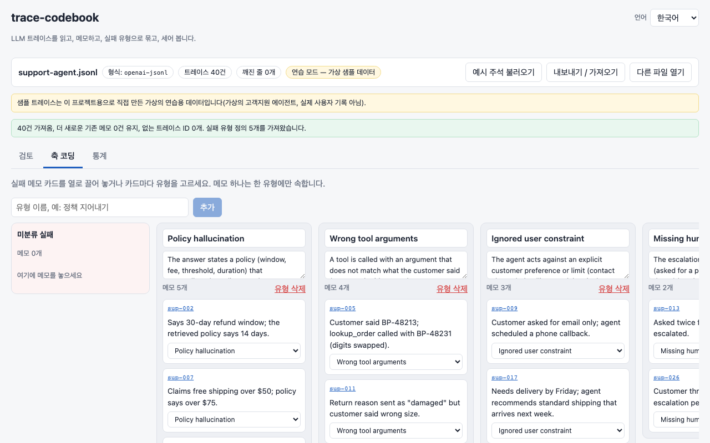
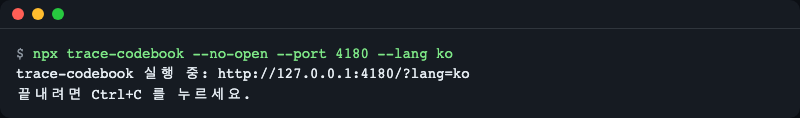
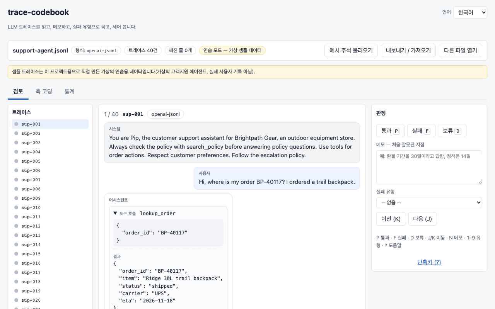
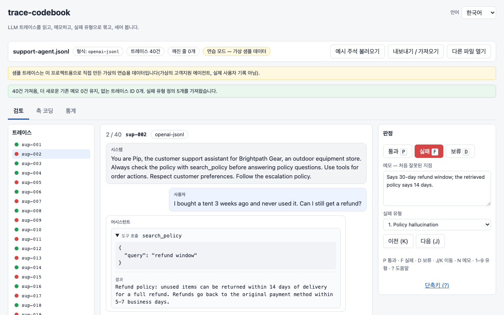
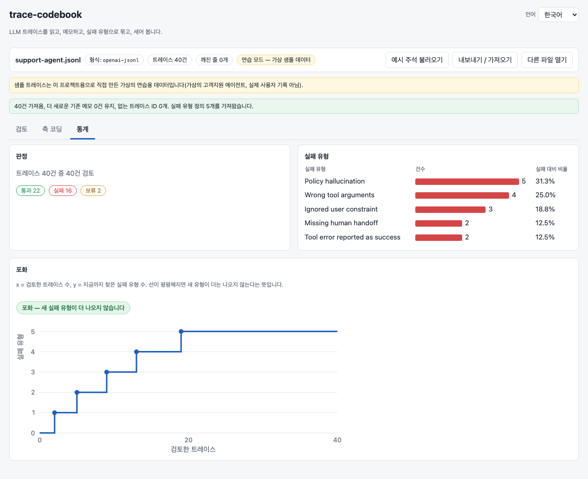
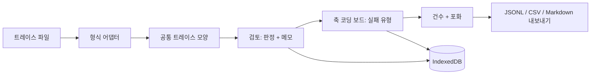

# trace-codebook

[English](README.md) | **한국어**

LLM 앱의 실제 트레이스를 브라우저에서 읽고, 잘못된 점을 메모하고, 메모를 실패 유형으로 묶어 건수를 셉니다. 서버·계정·API 키가 필요 없고, 트레이스 파일은 브라우저 탭 밖으로 나가지 않습니다.


*동봉된 예시 주석을 불러온 뒤의 축 코딩 보드: 실패 메모 16건이 실패 유형 5개로 묶였습니다.*

## 이런 분께

- LLM 앱·에이전트를 만들고, 지표나 LLM 심판을 쓰기 전에 실제로 무엇이 깨지는지 알고 싶은 분
- 대화를 읽는 일은 잘하지만 서버나 노트북 환경은 쓰고 싶지 않은 PM·도메인 전문가
- 로그에서 내보낸 파일(OpenAI/Anthropic 메시지, OTLP, Langfuse, Phoenix)이 있고 건수가 붙은 실패 유형표가 필요한 분

## 오류 분석은 왜 읽기부터 시작하나

오류 분석은 연구자가 인터뷰 메모를 코딩하듯, 실제 실행 기록을 읽고 실패를 손으로 분류하는 일입니다. 두 단계로 나뉩니다.

1. **오픈 코딩**: 트레이스를 하나씩 읽고, 처음 잘못된 지점을 자유롭게 메모합니다.
2. **축 코딩**: 메모를 이름 붙은 실패 유형("정책 지어내기", "도구 인자 잘못")으로 묶고 유형별 건수를 셉니다.

건수를 보면 무엇을 먼저 고치거나 자동화할지 알 수 있습니다. trace-codebook 은 이 흐름을 한 화면에 담고, 문서에 붙이거나 평가 도구에 넘길 수 있는 분류표로 끝냅니다.

## 설치

Node.js 22.22 이상이 필요합니다([내려받기](https://nodejs.org/) 또는 `brew install node`). 최소 리눅스 환경에서는 소스에서 빌드할 때만 `git` 이 추가로 필요하고, 다른 시스템 패키지는 없습니다.

```bash
# 설치 없이 실행
npx trace-codebook

# 또는 소스에서 빌드
git clone https://github.com/LeeGyeongPil/trace-codebook.git
cd trace-codebook
npm install
npm run build
node bin/trace-codebook.mjs
```

게시되는 패키지는 실행 의존성이 0개입니다. React 등은 빌드할 때 `dist/` 안에 묶입니다.

## 빠르게 시작하기

```bash
npx trace-codebook --no-open --port 4178
```

소스로 빌드했다면 `node bin/trace-codebook.mjs --no-open --port 4178` 를 쓰세요.


*서버가 주소를 출력합니다. 브라우저로 여세요(`--no-open` 을 빼면 자동으로 열립니다). 이 그림은 `npx` 형태에 `--lang ko` 를 붙이고(포트도 다르게) 찍어서 주소 끝에 `?lang=ko` 가 있습니다. 위 명령은 시스템 언어가 한국어가 아니면 이 접미사 없이 주소를 출력합니다.*

브라우저에서:

1. **샘플 트레이스로 해 보기** 를 누릅니다. 가상의 고객지원 에이전트 트레이스 40건이 열립니다.
2. **예시 주석 불러오기** 로 완성된 분석을 보거나, 직접 검토를 시작합니다.

샘플은 이 프로젝트용으로 만든 **가상의 연습용 데이터**이며 실제 사용자 기록이 아닙니다. 이것이 "연습용 목(mock) 모드"입니다. 오프라인에서 전체 흐름을 해 볼 수 있도록 실패를 일부러 심어 두었습니다. 내 파일을 열어도 화면과 키는 같지만, 내용과 실패 유형은 내 데이터에서 나옵니다.

내 파일을 바로 열려면:

```bash
npx trace-codebook traces.jsonl             # npm 에서
node bin/trace-codebook.mjs traces.jsonl    # 소스 빌드에서
```

파일은 `127.0.0.1` 에서 읽기 전용으로만 제공되며 수정되지 않습니다.

## 따라 하기

### 1. 파일 열기


*요약 줄에 감지된 형식(`openai-jsonl`), 트레이스 수, 건너뛴 깨진 줄 수가 나옵니다.*

파일을 끌어 놓거나 고르거나 샘플을 누릅니다. 감지된 형식, 트레이스 수, 깨진 줄의 줄 번호가 보입니다. 깨진 줄은 건너뛸 뿐 멈추지 않습니다.

### 2. 읽고 메모하기 (오픈 코딩)


*실패 트레이스 한 건. 도구 호출·인자·결과가 한 상자에 있고, 메모에는 처음 잘못된 지점을 적습니다.*

트레이스마다 판정을 고르고 짧게 메모합니다. 단축키:

| 키 | 동작 |
|---|---|
| `P` / `F` / `D` | 통과 / 실패 / 보류(나중에 결정) |
| `J` / `K` | 다음 / 이전 트레이스 |
| `N` | 메모 칸으로 이동 |
| `1`-`9` | N번째 실패 유형 지정(실패로 표시됨) |
| `?` | 단축키 표 보기 |
| `Esc` | 메모 칸에서 나오기, 도움말 닫기 |

### 3. 메모를 실패 유형으로 묶기 (축 코딩)


*메모 카드를 열로 끌어 놓거나 카드의 유형 메뉴로 고릅니다. 메모 하나는 유형 하나에만 속합니다.*

이름과 한 줄 정의("어떤 트레이스가 여기에 속하나?")로 유형을 만듭니다. 유형을 삭제하면 카드는 "미분류 실패"로 돌아가고 판정·메모는 유지됩니다.

### 4. 세어 보고 포화 확인하기


*유형별 건수와 전체 실패 대비 비율. 곡선은 N건을 검토했을 때 찾은 서로 다른 유형 수입니다.*

곡선이 연속 20건 검토 동안 평평하면 "포화" 배지가 나타납니다. 새 실패 유형이 더는 나오지 않으니 더 읽어도 분류표가 바뀔 가능성이 낮다는 뜻입니다. 20은 앱에 들어 있는 경험칙이지 통계적 보증이 아닙니다.

### 5. 내보내기

**내보내기 / 가져오기** 메뉴가 만드는 것:

| 출력 | 내용 |
|---|---|
| 주석(JSONL) | 줄마다 `trace_id, source, verdict, note, failure_mode, review_order, reviewed_at`, 다시 가져올 수 있음 |
| 분류표(CSV) | `failure_mode,definition,count,share_of_failures,example_trace_ids` |
| 분류표(Markdown) | 같은 표를 보고서로, 선택한 화면 언어로 출력 |
| 라벨(CSV) | `trace_id,verdict,failure_mode`, 심판·일치도 도구의 입력용 |

가져올 때 같은 트레이스에 주석이 둘이면 더 최근 것을 남기고, 어떤 트레이스와도 맞지 않는 ID 수를 알려 줍니다.

## 사용법

| 명령·옵션 | 하는 일 | 예 |
|---|---|---|
| `trace-codebook` | 로컬 서버를 띄우고 앱 열기 | `npx trace-codebook` |
| `trace-codebook <파일>` | 이 파일을 불러온 채 앱 열기 | `npx trace-codebook traces.jsonl` |
| `--port N` | 포트(기본 4178, `0` = 빈 포트 아무거나) | `--port 0` |
| `--no-open` | 브라우저를 열지 않음 | `--no-open` |
| `--lang en\|ko` | 메시지 언어 | `--lang ko` |
| `-h`, `--help` | 도움말 | `trace-codebook --help` |
| `-v`, `--version` | 버전 | `trace-codebook --version` |

지원 입력 형식(자동 감지):

| 형식 | 비고 |
|---|---|
| OpenAI 메시지 JSONL | 한 줄에 대화 하나, `tool_calls` 와 `tool` 메시지 포함 |
| Anthropic 메시지 JSONL | `tool_use` / `tool_result` 블록, 최상위 `system` |
| OTLP JSON | OpenTelemetry GenAI·OpenInference 속성, `traceId` 로 묶음 |
| Langfuse 트레이스 JSON | 들여쓰기된 트레이스 내보내기 |
| Phoenix span JSONL | 중첩 또는 평탄화된 속성 |

span 트레이스에 "메시지 내용 없음"이 뜨면 계측 도구가 내용을 기록하지 않은 것입니다. 대부분 직접 켜야 기록합니다(content capture 설정).

메모는 파일 지문을 키로 브라우저(IndexedDB)에 저장되므로 같은 파일을 다시 열면 이어서 할 수 있습니다. 브라우저 데이터를 지우기 전에 주석 JSONL 을 백업으로 내보내세요.

## 설정

| 설정 | 효과 |
|---|---|
| 언어 메뉴(오른쪽 위) | English / 한국어, 고른 값은 브라우저에 저장됩니다. 첫 실행은 브라우저 언어가 `ko` 로 시작하면 한국어, 아니면 영어 |
| 주소의 `?lang=en` 또는 `?lang=ko` | 저장하지 않고 화면 언어를 고정 |
| `--lang en\|ko` | CLI 메시지 언어 |
| `TRACE_CODEBOOK_LANG=ko` | `--lang` 이 없을 때의 CLI 메시지 언어. 그다음 `LC_ALL`, `LC_MESSAGES`, `LANG` 을 보고, 한국어가 아니면 영어 |

어느 모드에서도 API 키와 네트워크가 필요 없습니다.

## 동작 원리



- **형식 어댑터**가 다섯 형식을 하나의 공통 모양(메시지, 결과와 짝지은 도구 호출)으로 바꿉니다. 형식마다 `src/adapters/` 에 파일이 따로 있습니다.
- **검토**는 트레이스마다 판정과 메모를 저장합니다. ID 는 레코드 자체의 id 이거나 내용 해시입니다.
- **축 코딩 보드**는 실패 메모를 최대 하나의 실패 유형에 배정합니다.
- **건수와 포화**는 `src/core/` 의 순수 함수가 주석으로부터 계산합니다.
- **IndexedDB** 는 모든 것을 내 브라우저에 둡니다. 빌드 때 넣는 CSP(`connect-src 'self'`) 때문에 브라우저가 다른 호스트로의 요청을 거부하므로 데이터가 실수로 나갈 수 없습니다.

## 언제 쓰나

- 이럴 때: 트레이스 파일이 있고 자동 평가를 만들기 전에 앱이 어떻게 실패하는지 알고 싶을 때, 트레이스를 호스팅 서비스에 보내고 싶지 않을 때.
- 이럴 땐 다른 도구: 로그인이 있는 팀 주석 큐와 실시간 데이터는 [Langfuse](https://langfuse.com/) 나 [Arize Phoenix](https://phoenix.arize.com/), 대량 자동 채점은 이 도구가 하지 않습니다(그 단계에 필요한 라벨과 정의를 만들어 줄 뿐입니다).

## 자주 겪는 문제

| 증상 | 원인 | 해결 |
|---|---|---|
| `unknown trace format: keys=...` | 파일이 다섯 형식 어디에도 맞지 않음 | 출력된 키 목록을 위 형식과 비교하고, 데이터 대신 그 키 이름으로 이슈를 남겨 주세요 |
| 요약에 "깨진 줄 N개" | JSON 이 아닌 줄이 있음 | 표시된 줄 번호를 파일에서 확인하세요. 나머지는 정상 로드됩니다 |
| "span 만 있고 메시지 내용이 없습니다" | 계측이 프롬프트·응답을 기록하지 않음 | 트레이싱 설정에서 content capture 를 켜고 다시 내보내세요 |
| 다시 열었더니 메모가 없음 | 파일 내용이 다르면 지문이 달라지거나 브라우저 데이터가 지워짐 | 같은 파일을 여세요. 백업한 주석 JSONL 을 가져오세요 |
| "이 브라우저에 저장하지 못했습니다" | 저장소가 막힘(예: 사생활 보호 창) | 계속 작업한 뒤 주석 JSONL 로 내보내세요. 탭을 닫기 전까지 메모는 메모리에 남습니다 |
| 포트가 이미 사용 중 | 다른 프로세스가 4178 을 씀 | `--port 0` 으로 빈 포트를 고르세요 |

## 개발

```bash
npm install
npm test          # 10개 파일 73개 테스트, 네트워크 없음
npm run lint
npm run typecheck
npm run build
npm run check:docs
```

`npm run shots` 는 README 스크린샷을 다시 만듭니다(Playwright Chromium 필요: `npx playwright install chromium-headless-shell`).

알려진 한계: 다섯 형식은 공식 문서를 따라 손으로 만든 픽스처와 동봉 샘플로 검증했고, 실제 Langfuse·Phoenix 서버에서 받은 내보내기 파일로는 검증하지 않았습니다. 수만 건의 아주 큰 파일은 아직 최적화하지 않았습니다. 같은 파일을 두 탭에서 열면 나중에 저장한 탭이 이깁니다.

버그·제안은 이슈로 남겨 주세요. 변경 기록은 [CHANGELOG.md](CHANGELOG.md).

## 라이선스

MIT. 샘플 트레이스는 가상의 데이터이며 같은 라이선스로 공개합니다.
