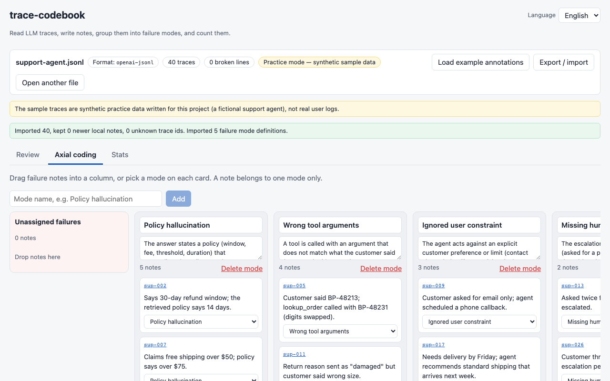
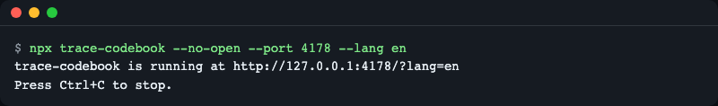
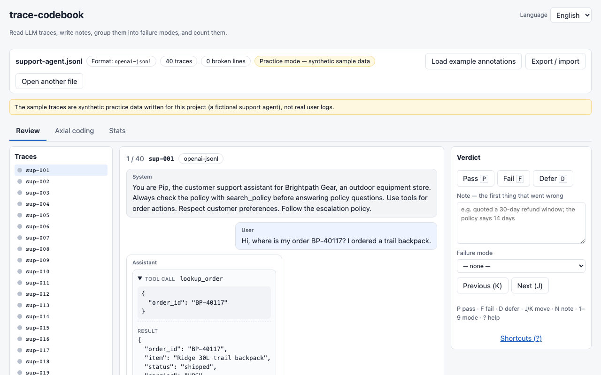
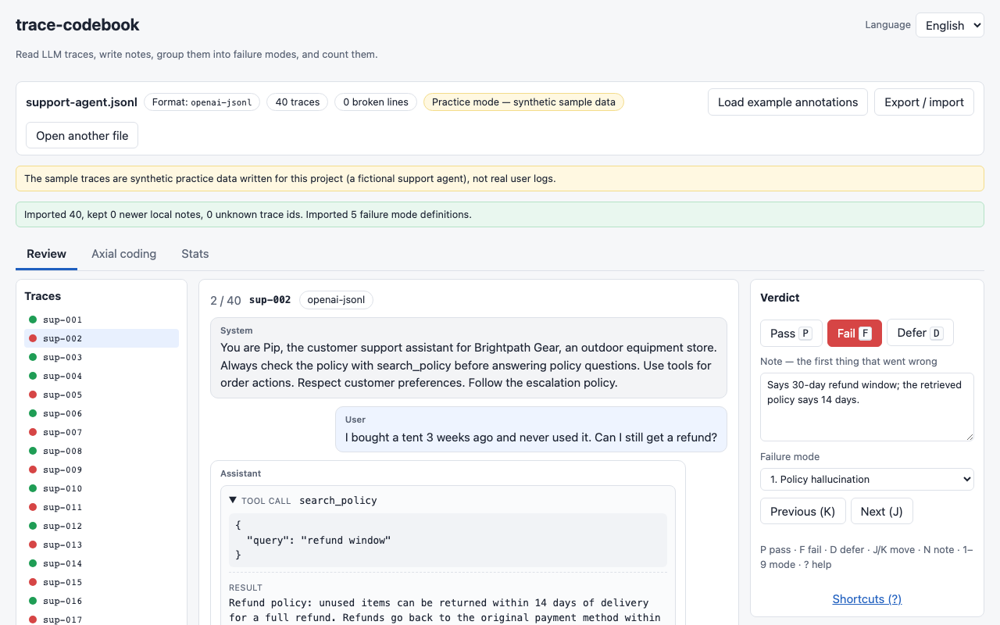
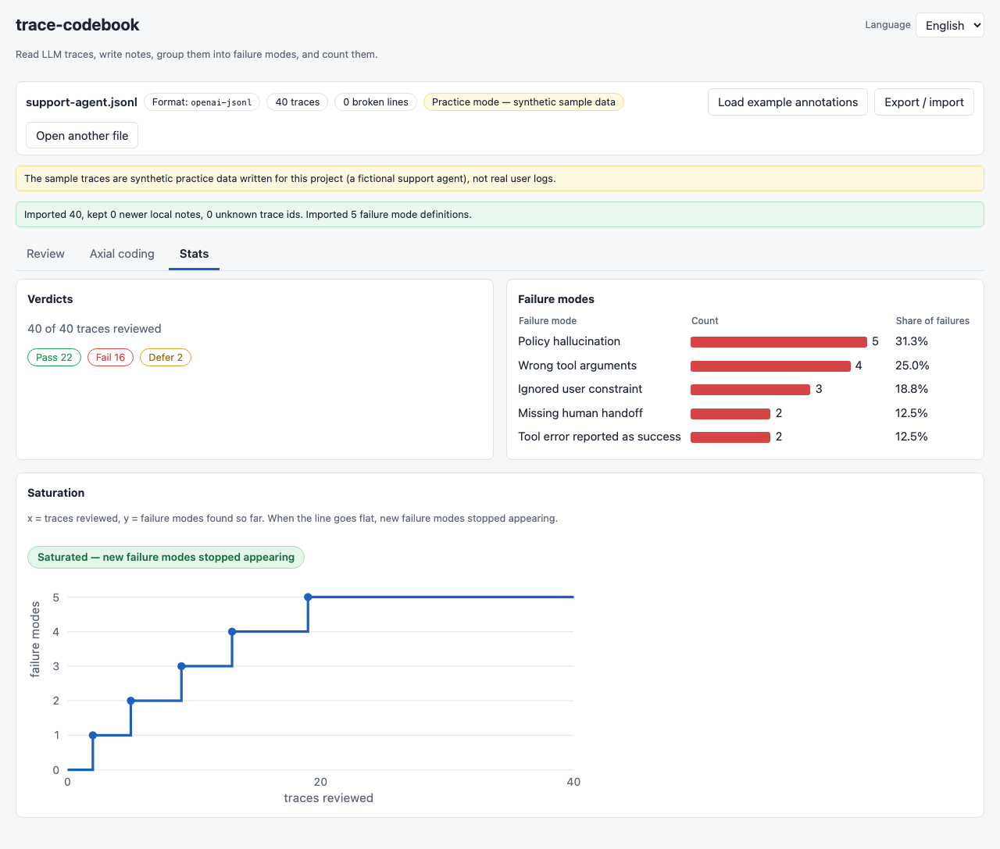
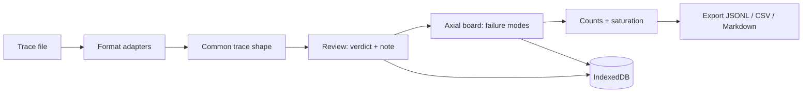

# trace-codebook

**English** | [한국어](README.ko.md)

Read your LLM app's real traces in the browser, write down what went wrong, group the notes into failure modes, and count them. No server, no account, no API key: your trace file never leaves the browser tab.


*The axial coding board after loading the bundled example annotations: 16 failure notes grouped into 5 failure modes.*

## Who it is for

- You build an LLM app or agent and want to know what actually breaks before you write metrics or an LLM judge.
- You are a PM or domain expert who reads conversations well but should not need a server or a notebook.
- You have an export file from your logs (OpenAI/Anthropic messages, OTLP, Langfuse, Phoenix) and want a failure-mode table with counts.

## Why error analysis starts with reading

Error analysis means reading real runs and sorting the failures by hand, the way a researcher codes interview notes. It has two passes:

1. **Open coding**: read one trace at a time and write a free-form note about the first thing that went wrong.
2. **Axial coding**: group those notes into named failure modes ("Policy hallucination", "Wrong tool arguments") and count each group.

The counts tell you which problem to fix or to automate first. trace-codebook puts this loop in one screen and ends with a taxonomy table you can paste into a doc or hand to an eval tool.

## Install

Requires Node.js 22.22 or newer ([download](https://nodejs.org/) or `brew install node`). On a minimal Linux image you also need `git` only if you build from source; there are no other system packages.

```bash
# Run without installing
npx trace-codebook

# Or build from source
git clone https://github.com/LeeGyeongPil/trace-codebook.git
cd trace-codebook
npm install
npm run build
node bin/trace-codebook.mjs
```

The published package has zero runtime dependencies: React and the other libraries are bundled into `dist/` at build time.

## Quick start

```bash
npx trace-codebook --no-open --port 4178
```

If you built from source, use `node bin/trace-codebook.mjs --no-open --port 4178` instead.


*The server prints its address. Open it in a browser (without `--no-open` it opens for you). The picture was taken with the `npx` form plus `--lang en` (and a different port), so its address ends in `?lang=en`; the command above prints the address without that suffix when your system language is not Korean.*

Then in the browser:

1. Click **Try sample traces**. This loads 40 traces of a fictional support agent.
2. Click **Load example annotations** to see a finished analysis, or start reviewing yourself.

The sample is **synthetic practice data** written for this project, not real user logs. It is the "practice (mock) mode": it lets you try the whole flow offline, with failures planted so you can see what a finished analysis looks like. With your own file the screens and keys are the same, but the content and the failure modes come from your data.

To open your own file directly:

```bash
npx trace-codebook traces.jsonl             # from npm
node bin/trace-codebook.mjs traces.jsonl    # from a source build
```

The file is served read-only from `127.0.0.1` and is never modified.

## Walkthrough

### 1. Open a file


*The summary line shows the detected format (`openai-jsonl`), the number of traces, and how many lines were broken and skipped.*

What you do: drop a file on the page, choose one, or click the sample. What you see: the detected format, the trace count, and the line numbers of any broken lines. Broken lines are skipped, not fatal.

### 2. Review and write notes (open coding)


*One failed trace. The tool call, its arguments and its result sit together in one box. The note records the first thing that went wrong.*

For each trace choose a verdict and write a short note. Keys:

| Key | Action |
|---|---|
| `P` / `F` / `D` | Mark pass / fail / defer (decide later) |
| `J` / `K` | Next / previous trace |
| `N` | Focus the note field |
| `1`-`9` | Assign the Nth failure mode (marks as fail) |
| `?` | Show the shortcut list |
| `Esc` | Leave the note field, close help |

### 3. Group notes into failure modes (axial coding)


*Drag a note card into a column, or use the Mode menu on each card. A note belongs to one mode only.*

Create a mode with a name and a one-line definition ("when does a trace belong here?"). Deleting a mode moves its cards back to "Unassigned failures"; verdicts and notes are kept.

### 4. Count and check saturation


*Counts per failure mode and the share of all failures. The curve shows how many distinct modes you had found after N reviewed traces.*

When the curve stays flat for 20 reviews in a row, a "Saturated" badge appears: new failure modes stopped appearing, so reading more traces is unlikely to change the taxonomy. 20 is a rule of thumb built into the app, not a statistical guarantee.

### 5. Export

The **Export / import** menu writes:

| Output | Content |
|---|---|
| Annotations (JSONL) | `trace_id, source, verdict, note, failure_mode, review_order, reviewed_at` per line; importable again |
| Taxonomy (CSV) | `failure_mode,definition,count,share_of_failures,example_trace_ids` |
| Taxonomy (Markdown) | The same table as a report, in the chosen UI language |
| Labels (CSV) | `trace_id,verdict,failure_mode`, as input for judge or agreement tools |

Importing keeps the newer note when the same trace was annotated twice and counts ids that match no trace.

## Usage

| Command / option | What it does | Example |
|---|---|---|
| `trace-codebook` | Start the local server and open the app | `npx trace-codebook` |
| `trace-codebook <file>` | Open the app with this file loaded | `npx trace-codebook traces.jsonl` |
| `--port N` | Port to listen on (default 4178, `0` = any free port) | `--port 0` |
| `--no-open` | Do not open a browser | `--no-open` |
| `--lang en\|ko` | Message language | `--lang ko` |
| `-h`, `--help` | Show help | `trace-codebook --help` |
| `-v`, `--version` | Show the version | `trace-codebook --version` |

Supported input formats (detected automatically):

| Format | Notes |
|---|---|
| OpenAI messages JSONL | one conversation per line, with `tool_calls` and `tool` messages |
| Anthropic messages JSONL | `tool_use` / `tool_result` blocks, top-level `system` |
| OTLP JSON | OpenTelemetry GenAI and OpenInference attributes, grouped by `traceId` |
| Langfuse trace JSON | a pretty-printed trace export |
| Phoenix span JSONL | nested or flattened attributes |

If a span trace shows "no message content", your instrumentation did not record it. Most do so only when you opt in (the content capture setting).

Your notes are saved in the browser (IndexedDB), keyed by a fingerprint of the file, so reopening the same file resumes where you stopped. Export the annotations JSONL as a backup before clearing browser data.

## Settings

| Setting | Effect |
|---|---|
| Language menu (top right) | English / 한국어; the choice is saved in the browser. On first run Korean is used if the browser language starts with `ko`, otherwise English |
| `?lang=en` or `?lang=ko` in the address | Forces the screen language without saving it |
| `--lang en\|ko` | CLI message language |
| `TRACE_CODEBOOK_LANG=ko` | CLI message language when `--lang` is not given; then `LC_ALL`, `LC_MESSAGES`, `LANG` are checked, and anything that is not Korean means English |

No API key or network access is needed in any mode.

## How it works



- **Format adapters** turn each of the five formats into one common shape (messages, tool calls with their results). Each format has its own file in `src/adapters/`.
- **Review** stores a verdict and a note per trace; the id is the record's own id or a hash of its content.
- **Axial board** assigns each failure note to at most one failure mode.
- **Counts and saturation** are computed from those annotations by pure functions in `src/core/`.
- **IndexedDB** keeps everything in your browser; a build-time Content-Security-Policy (`connect-src 'self'`) makes the browser refuse requests to other hosts, so data cannot be sent out by mistake.

## When to use it

- Good fit: you have trace files and want to find out how your app fails before building automated evals; you want to do it without sending traces to a hosted service.
- Other tools fit better for: team annotation queues with logins and live data in [Langfuse](https://langfuse.com/) or [Arize Phoenix](https://phoenix.arize.com/); automated scoring at scale, which this tool does not do (it produces the labels and definitions that such a step needs).

## Troubleshooting

| Symptom | Cause | Fix |
|---|---|---|
| `unknown trace format: keys=...` | The file matches none of the five formats | Check the listed keys against the formats above; open an issue with those key names (not your data) |
| "N broken lines" in the summary | Some lines are not valid JSON | Open the listed line numbers in the file; the rest still loads |
| "spans but no message content" | The instrumentation did not capture prompts and replies | Turn on content capture in your tracing setup and export again |
| Notes seem gone after reopening | Different file contents give a different fingerprint, or browser data was cleared | Open the same file; import your annotations JSONL backup |
| "Could not save to this browser" | Storage is blocked (for example a private window) | Keep working, then export the annotations JSONL; notes stay in memory until the tab closes |
| Port already in use | Another process uses 4178 | `--port 0` picks a free port |

## Development

```bash
npm install
npm test          # 73 tests in 10 files, no network
npm run lint
npm run typecheck
npm run build
npm run check:docs
```

`npm run shots` regenerates the README screenshots (needs Playwright's Chromium: `npx playwright install chromium-headless-shell`).

Known limits: the five formats are verified against hand-built fixtures that follow the official docs and the bundled samples, not against exports from real Langfuse or Phoenix servers. Very large files (tens of thousands of traces) are not optimized yet. Opening the same file in two tabs means the tab that saves last wins.

Bugs and ideas are welcome as issues. Changes are listed in [CHANGELOG.md](CHANGELOG.md).

## License

MIT. The sample traces are synthetic and are released under the same license.
